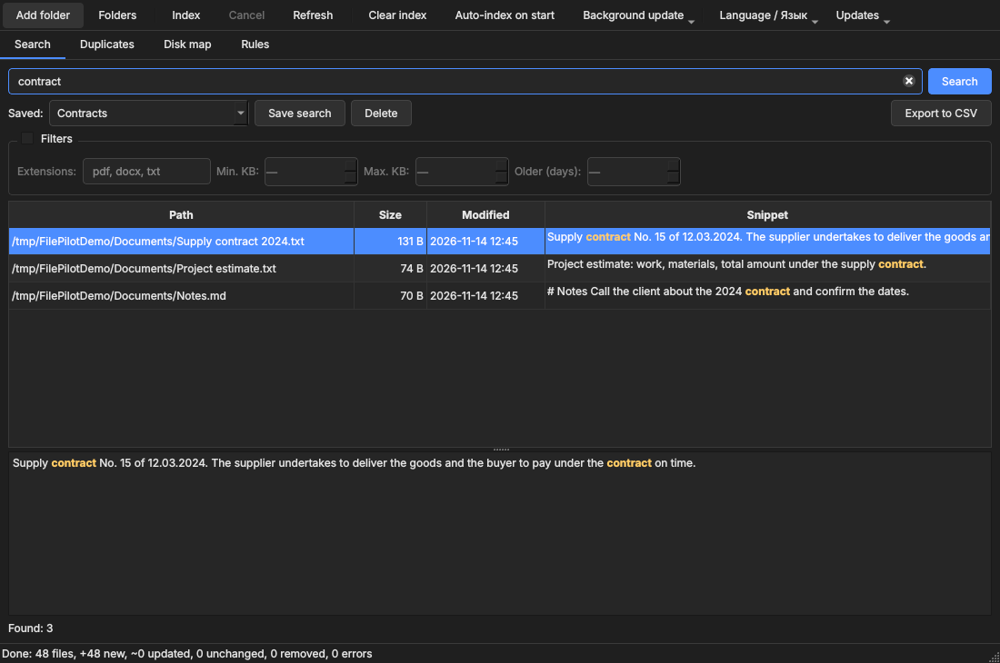
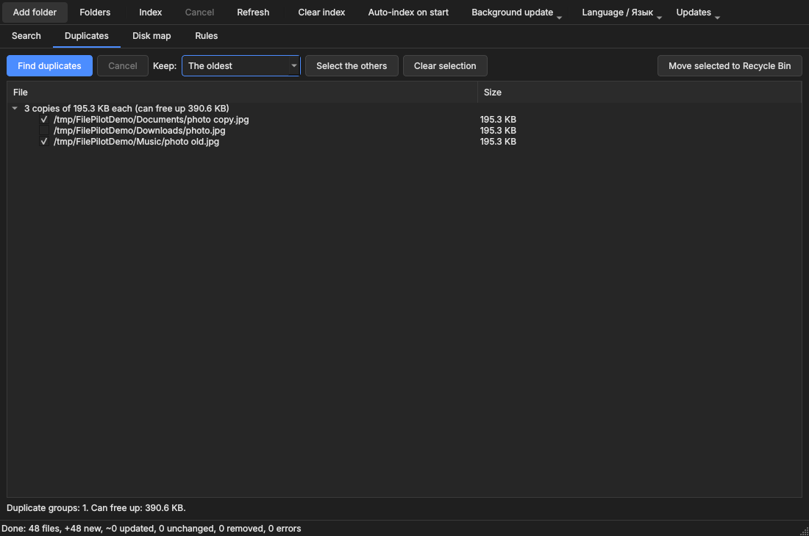
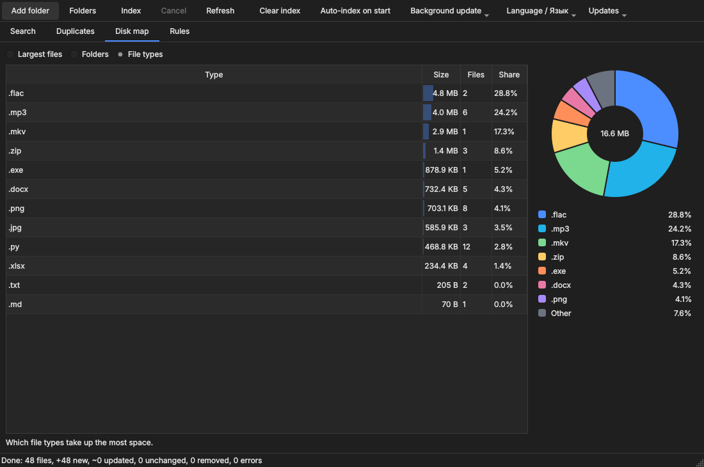
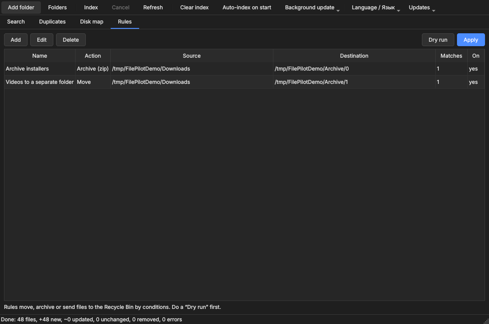
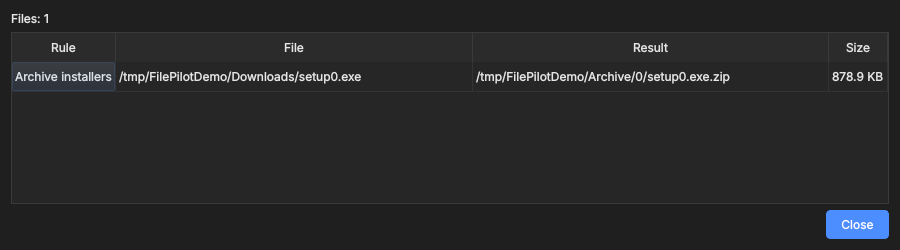

# FilePilot

[Русский](README.md) · **English**

A local Windows app: search inside your files, find duplicates, see what takes up disk space, and auto-sort files with rules.
Everything runs on your computer and the index is stored locally. Open source, MIT license.

**[Download the installer](https://github.com/dyrty11/filepilot/releases/latest/download/FilePilotSetup.exe)** · [Portable version (.zip)](https://github.com/dyrty11/filepilot/releases/latest/download/FilePilot-Portable.zip) · [Project page on my site](https://dyrty11.github.io/project-filepilot.html) · [All releases](../../releases)



## Features

- **Full-text search** (txt, code, pdf, docx, xlsx, pptx, odt and more): filters by extension, size and age, a preview of the found text with highlighting, saved searches, CSV export.
- **Duplicates**: compared by content. Choose which copy to keep (oldest, newest, shortest path). Files only go to the Recycle Bin, and at least one copy always stays in every group.
- **Disk map**: largest files, folders and file types, with a donut chart.
- **Auto-sorting rules**: move, archive to zip or send to the Recycle Bin by folder, extension, name pattern and file age. "Dry run" shows the result before you apply it. There is no permanent delete.
- **Index**: auto-index on start, background refresh on a timer (15 minutes, hour, 6 hours), cancel, clear.
- **Russian and English UI**: chosen from the system language or with the "Language / Язык" button.
- **Updates**: a check once a day, one-click install, and a "What's new" window after updating.
- **Privacy**: your files, index and paths are never sent anywhere. The only network request is the update check on GitHub (can be turned off).

| Duplicates | Disk map |
|---|---|
|  |  |
| **Rules** | **Rule dry run** |
|  |  |

## Install (Windows 10/11)

Download from the [site](https://dyrty11.github.io/project-filepilot.html) or the [Releases](../../releases) page:

- [`FilePilotSetup.exe`](https://github.com/dyrty11/filepilot/releases/latest/download/FilePilotSetup.exe): installer (Russian and English, upgrades version 0.1 in place);
- [`FilePilot-Portable.zip`](https://github.com/dyrty11/filepilot/releases/latest/download/FilePilot-Portable.zip): portable version, unzip and run `FilePilot.exe`. Data is kept in the `FilePilotData` folder next to the program.

SHA-256 checksums are in [`SHA256SUMS.txt`](https://github.com/dyrty11/filepilot/releases/latest/download/SHA256SUMS.txt) in the same release. Check in PowerShell:

```
Get-FileHash .\FilePilotSetup.exe -Algorithm SHA256
```

Windows SmartScreen may show an "Unknown publisher" warning: the installer is not code-signed yet. Compare the checksum, then click "More info" → "Run anyway". The source is open and the EXE is built by GitHub Actions from this repository.

## Updates

Once a day (turn it off in the "Updates" menu → "Check on start") the app makes one request to GitHub and offers to install a new version if there is one. The installer is downloaded only from github.com, verified against the SHA-256 in `SHA256SUMS.txt` and run over the current version; your data is not touched. After updating, the app shows a notification and a "What's new" window. The portable version and running from source only open the release page.

## Run from source

```
python -m venv .venv
.venv\Scripts\activate
pip install -r requirements.txt
python -m filepilot
```

## Command line

```
python -m filepilot folders add "C:\Users\You\Documents"
python -m filepilot index
python -m filepilot search "contract 2024" --ext pdf,docx --older 30
python -m filepilot dupes
python -m filepilot top
python -m filepilot rules run            # dry run
python -m filepilot rules run --apply    # apply
```

Command-line messages are currently in Russian.

## Build and tests

`build.bat` installs dependencies, runs the tests, builds `dist\FilePilot` (PyInstaller), a portable zip and, if Inno Setup is installed, the installer. It prints the SHA-256 at the end. A GitHub release builds itself: a `v*` tag runs `.github/workflows/release.yml`. Screenshots for this README are made by `scripts/make_screenshots.py`.

```
pip install pytest
pytest
```

## License

MIT, see [LICENSE](LICENSE). The UI uses PySide6 (Qt) under LGPLv3, see [THIRD_PARTY.md](THIRD_PARTY.md).
