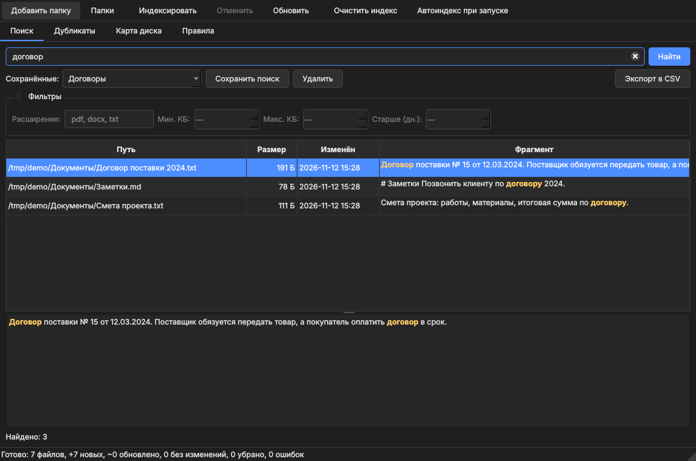
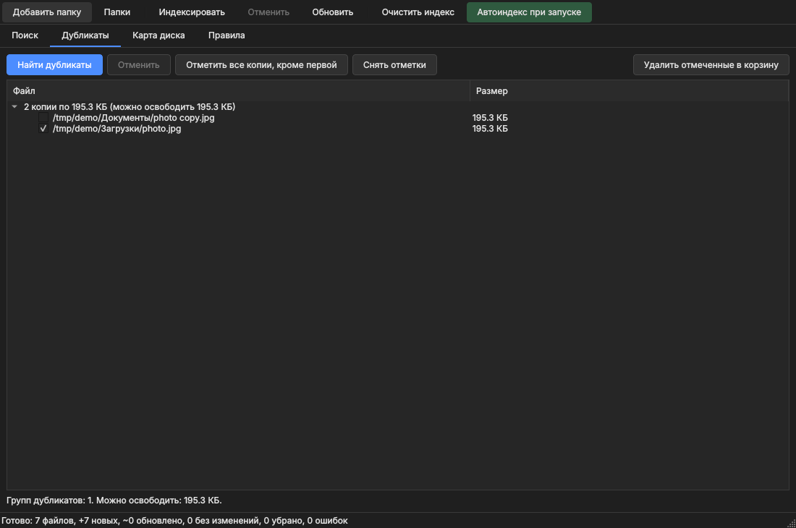
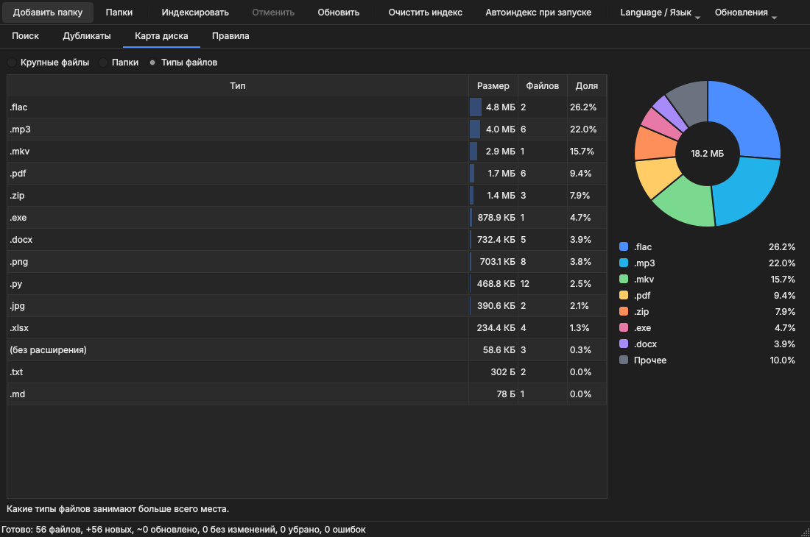
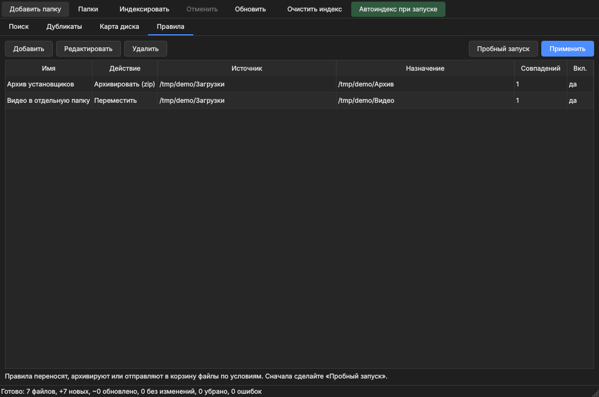

# FilePilot

Локальная программа для Windows: поиск по содержимому файлов, поиск дубликатов, карта диска и правила автосортировки.
Всё работает на вашем компьютере, индекс хранится локально.



## Установка (Windows)

Скачайте на странице [Releases](../../releases):

- `FilePilotSetup-0.3.1.exe` — установщик (обновляет версию 0.1 на месте);
- `FilePilot-Portable.zip` — переносная версия: распакуйте и запустите `FilePilot.exe`. Данные лежат в папке `FilePilotData` рядом с программой.

Контрольные суммы SHA-256 лежат в `SHA256SUMS.txt` в том же релизе. Проверка в PowerShell:

```
Get-FileHash .\FilePilotSetup-0.3.1.exe -Algorithm SHA256
```

## Обновления

Раз в сутки (можно отключить: меню «Обновления» → «Проверять при запуске») программа делает один запрос к GitHub и, если вышла новая версия, предлагает её установить. Установщик скачивается только с github.com, проверяется по SHA-256 из `SHA256SUMS.txt` и запускается поверх текущей версии; ваши данные не затрагиваются. Ничего, кроме обычного HTTP-запроса, не отправляется. Портативная версия и запуск из исходников только открывают страницу релиза.

Windows SmartScreen может показать предупреждение: файлы не подписаны сертификатом. Исходный код открыт, EXE собирается в GitHub Actions из этого репозитория.

## Запуск из исходников

```
python -m venv .venv
.venv\Scripts\activate
pip install -r requirements.txt
python -m filepilot --help
```

Запуск окна: `python -m filepilot` (или `python run.py`).

## Возможности

- **Поиск** по содержимому (txt, код, pdf, docx, xlsx, pptx, odt и др.) с фильтрами по расширению, размеру и возрасту файлов, предпросмотром с подсветкой, сохранёнными поисками и экспортом в CSV.
- **Дубликаты**: сравнение по содержимому, удаление только в корзину, в каждой группе остаётся копия.
- **Карта диска**: крупные файлы, папки и типы файлов, с кольцевой диаграммой.
- **Правила**: перенос, архивация в zip или отправка в корзину с пробным запуском. Окончательного удаления нет.
- **Русский и английский интерфейс**: язык выбирается по системе или в меню «Language / Язык».
- **Автоиндекс при запуске**, очистка индекса, отмена индексации.

| Дубликаты | Карта диска | Правила |
|---|---|---|
|  |  |  |

## Консольные команды

```
python -m filepilot folders add "C:\Users\Вы\Documents"
python -m filepilot index
python -m filepilot search "договор 2024" --ext pdf,docx --older 30
python -m filepilot dupes
python -m filepilot top
python -m filepilot rules run            # пробный запуск
python -m filepilot rules run --apply    # выполнить
```

## Сборка

`build.bat` ставит зависимости, запускает тесты, собирает `dist\FilePilot` (PyInstaller), портативный zip и, если установлен Inno Setup, установщик. В конце печатает SHA-256.

Релиз на GitHub собирается сам: тег `v*` запускает `.github/workflows/release.yml`.

## Тесты

```
pip install pytest
pytest
```

## Лицензия

MIT, см. `LICENSE`. Интерфейс использует PySide6 (Qt) под лицензией LGPLv3.
