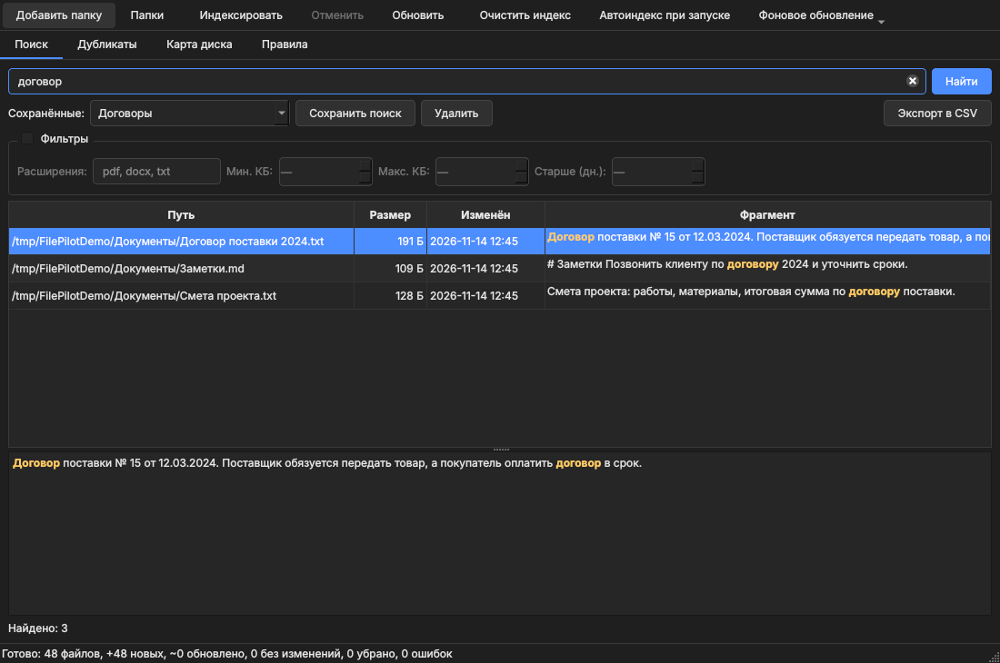
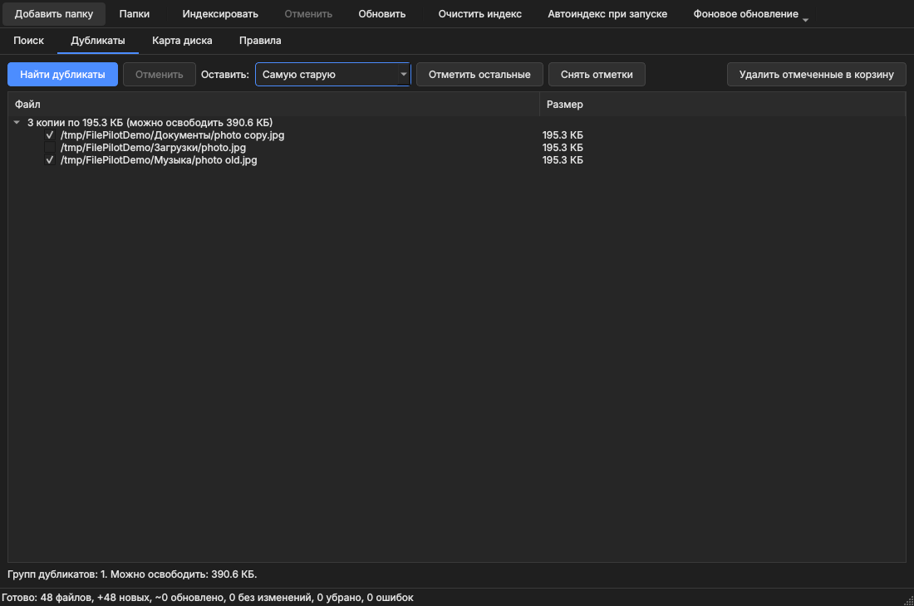
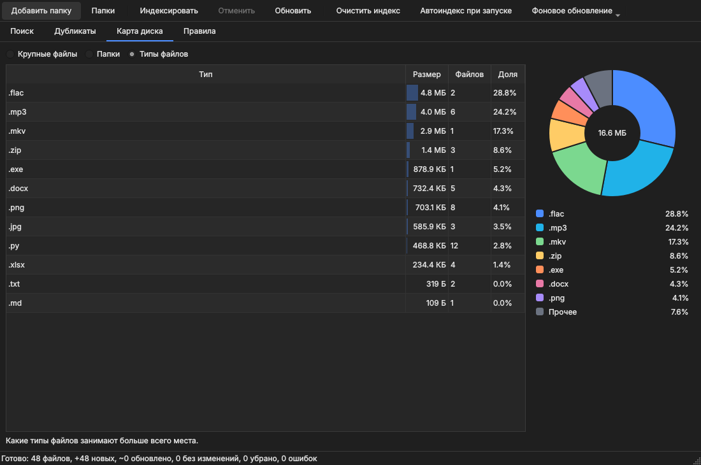
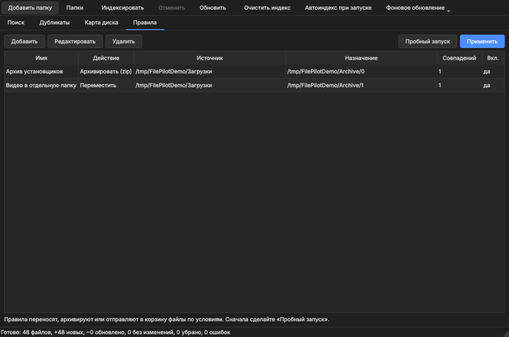
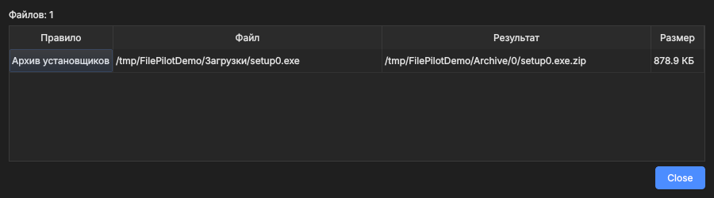

# FilePilot

**Русский** · [English](README.en.md)

Локальная программа для Windows: поиск по содержимому файлов, поиск дубликатов, карта диска и правила автосортировки.
Всё работает на вашем компьютере, индекс хранится локально. Открытый исходный код, лицензия MIT.

**[Скачать установщик](https://github.com/dyrty11/filepilot/releases/latest/download/FilePilotSetup.exe)** · [Переносная версия (.zip)](https://github.com/dyrty11/filepilot/releases/latest/download/FilePilot-Portable.zip) · [Страница программы на сайте](https://dyrty11.github.io/project-filepilot.html) · [Все релизы](../../releases)



## Что умеет

- **Поиск по содержимому** (txt, код, pdf, docx, xlsx, pptx, odt и др.): фильтры по расширению, размеру и возрасту файлов, предпросмотр найденного текста с подсветкой, сохранённые поиски, экспорт результатов в CSV.
- **Дубликаты**: сравнение по содержимому. Можно выбрать, какую копию оставить (старую, новую, с коротким путём). Удаление только в корзину, в каждой группе остаётся хотя бы одна копия.
- **Карта диска**: крупные файлы, папки и типы файлов, кольцевая диаграмма.
- **Правила автосортировки**: перенос, архивация в zip или отправка в корзину по папке, расширению, шаблону имени и возрасту файлов. «Пробный запуск» показывает результат до применения. Окончательного удаления нет.
- **Индекс**: автоиндекс при запуске, фоновое обновление по таймеру (15 минут, час, 6 часов), отмена, очистка.
- **Русский и английский интерфейс**: язык выбирается по системе или кнопкой «Language / Язык».
- **Обновления**: проверка раз в сутки, установка одним нажатием, окно «Что нового» после обновления.
- **Приватность**: файлы, индекс и пути никуда не отправляются. Единственное обращение к сети: проверка обновлений на GitHub (отключается).

| Дубликаты | Карта диска |
|---|---|
|  |  |
| **Правила** | **Пробный запуск правила** |
|  |  |

## Установка (Windows 10/11)

Скачайте с [сайта](https://dyrty11.github.io/project-filepilot.html) или со страницы [Releases](../../releases):

- [`FilePilotSetup.exe`](https://github.com/dyrty11/filepilot/releases/latest/download/FilePilotSetup.exe) — установщик (русский и английский язык, обновляет версию 0.1 на месте);
- [`FilePilot-Portable.zip`](https://github.com/dyrty11/filepilot/releases/latest/download/FilePilot-Portable.zip) — переносная версия: распакуйте и запустите `FilePilot.exe`. Данные лежат в папке `FilePilotData` рядом с программой.

Контрольные суммы SHA-256 лежат в [`SHA256SUMS.txt`](https://github.com/dyrty11/filepilot/releases/latest/download/SHA256SUMS.txt) в том же релизе. Проверка в PowerShell:

```
Get-FileHash .\FilePilotSetup.exe -Algorithm SHA256
```

Windows SmartScreen может показать предупреждение «Неизвестный издатель»: установщик пока не подписан сертификатом. Сверьте сумму и нажмите «Подробнее» → «Выполнить в любом случае». Исходный код открыт, EXE собирается в GitHub Actions из этого репозитория.

## Обновления

Раз в сутки (можно отключить: меню «Обновления» → «Проверять при запуске») программа делает один запрос к GitHub и, если вышла новая версия, предлагает её установить. Установщик скачивается только с github.com, проверяется по SHA-256 из `SHA256SUMS.txt` и запускается поверх текущей версии; ваши данные не затрагиваются. После обновления программа показывает уведомление и окно «Что нового». Портативная версия и запуск из исходников только открывают страницу релиза.

## Запуск из исходников

```
python -m venv .venv
.venv\Scripts\activate
pip install -r requirements.txt
python -m filepilot
```

## Консольные команды

```
python -m filepilot folders add "C:\Users\Вы\Documents"
python -m filepilot index
python -m filepilot search "договор 2024" --ext pdf,docx --older 30
python -m filepilot dupes
python -m filepilot top
python -m filepilot rules run            # пробный запуск
python -m filepilot rules run --apply    # выполнить
```

## Сборка и тесты

`build.bat` ставит зависимости, запускает тесты, собирает `dist\FilePilot` (PyInstaller), портативный zip и, если установлен Inno Setup, установщик. В конце печатает SHA-256. Релиз на GitHub собирается сам: тег `v*` запускает `.github/workflows/release.yml`. Скриншоты для README делает `scripts/make_screenshots.py`.

```
pip install pytest
pytest
```

## Лицензия

MIT, см. [LICENSE](LICENSE). Интерфейс использует PySide6 (Qt) под лицензией LGPLv3, подробнее в [THIRD_PARTY.md](THIRD_PARTY.md).
